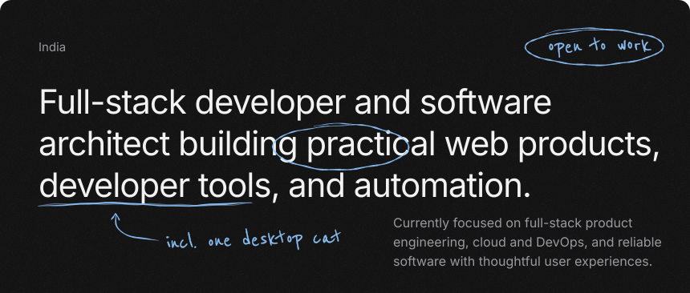
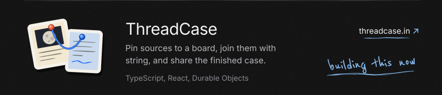
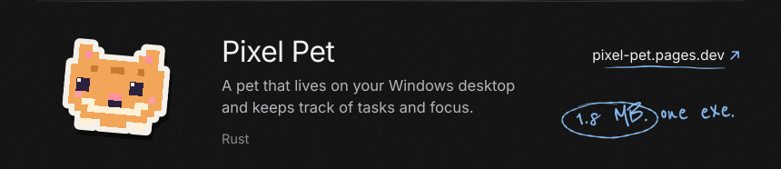
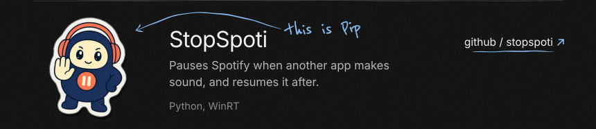
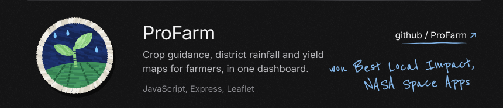
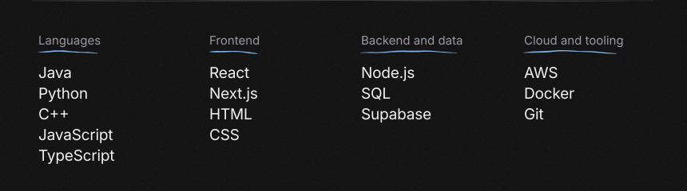

<a href="https://devlogue.pages.dev/"><picture><source media="(max-width: 1011px)" srcset="assets/intro-m.svg"></picture></a>
<a href="https://threadcase.in"><picture><source media="(max-width: 1011px)" srcset="assets/work-threadcase-m.svg"></picture></a>
<a href="https://pixel-pet.pages.dev"><picture><source media="(max-width: 1011px)" srcset="assets/work-pixel-pet-m.svg"></picture></a>
<a href="https://github.com/Shreeniwas1/stopspoti"><picture><source media="(max-width: 1011px)" srcset="assets/work-stopspoti-m.svg"></picture></a>
<a href="https://github.com/Shreeniwas1/ProFarm-NASA-space-apps-"><picture><source media="(max-width: 1011px)" srcset="assets/work-profarm-m.svg"></picture></a>
<a href="https://devlogue.pages.dev/"><picture><source media="(max-width: 1011px)" srcset="assets/stack-m.svg"></picture></a>
<a href="https://devlogue.pages.dev/"><picture><source media="(max-width: 1011px)" srcset="assets/hire-m.svg"></picture></a>
<a href="https://www.linkedin.com/in/shreeniwas-bondge/"><picture><source media="(max-width: 1011px)" srcset="assets/link-hire-me-m.svg"></picture></a><a href="https://devlogue.pages.dev/"><picture><source media="(max-width: 1011px)" srcset="assets/link-portfolio-m.svg"></picture></a><a href="https://devlogue.pages.dev/resume.pdf"><picture><source media="(max-width: 1011px)" srcset="assets/link-resume-m.svg"></picture></a>

Plain text

Full-stack developer and software architect building practical web products, developer tools, and automation. Based in India, open to internships and job offers.

Currently focused on full-stack product engineering, cloud and DevOps, and creating reliable software with thoughtful user experiences.

- **[ThreadCase](https://threadcase.in)**: pin sources to a board, join them with string, and share the finished case.
- **[Pixel Pet](https://pixel-pet.pages.dev)**: a pet that lives on your Windows desktop and keeps track of tasks and focus. 1.8 MB, one exe.
- **[StopSpoti](https://github.com/Shreeniwas1/stopspoti)**: pauses Spotify when another app makes sound, and resumes it after.
- **[ProFarm](https://github.com/Shreeniwas1/ProFarm-NASA-space-apps-)**: crop guidance, district rainfall and yield maps for farmers. Best Local Impact, NASA Space Apps.

| | |
|:--|:--|
| Languages | Java, Python, C++, JavaScript, TypeScript |
| Frontend | React, Next.js, HTML, CSS |
| Backend and data | Node.js, SQL, Supabase |
| Cloud and tooling | AWS, Docker, Git |

[LinkedIn](https://www.linkedin.com/in/shreeniwas-bondge/) · [Portfolio](https://devlogue.pages.dev/) · [Résumé](https://devlogue.pages.dev/resume.pdf)

